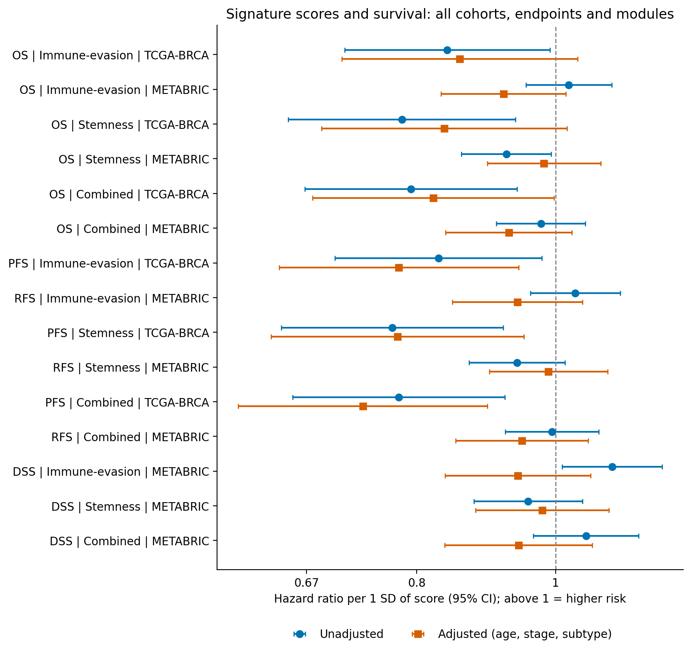
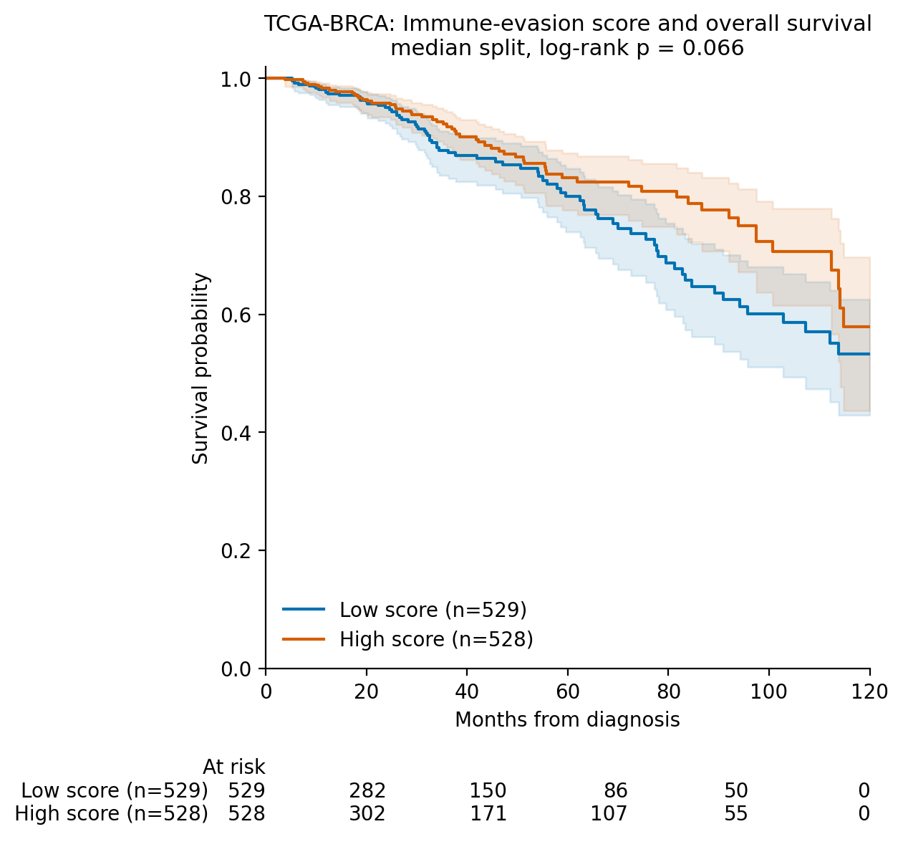
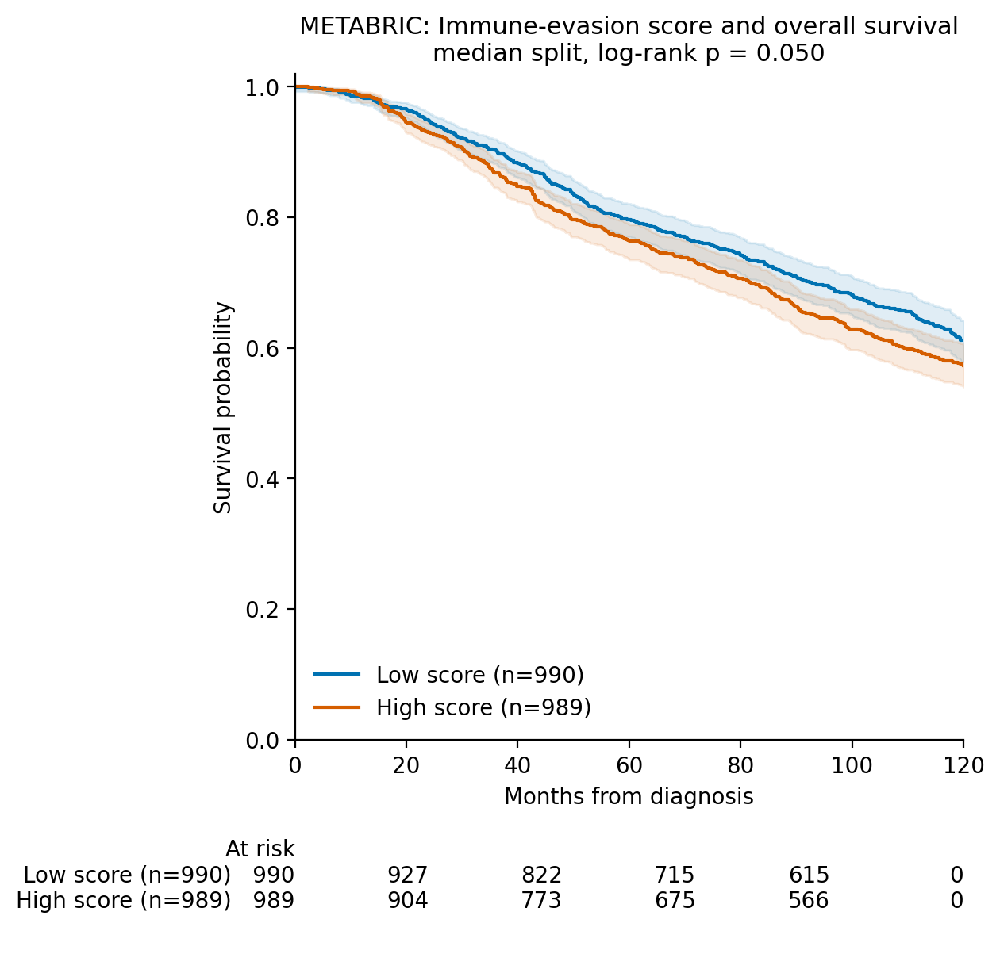
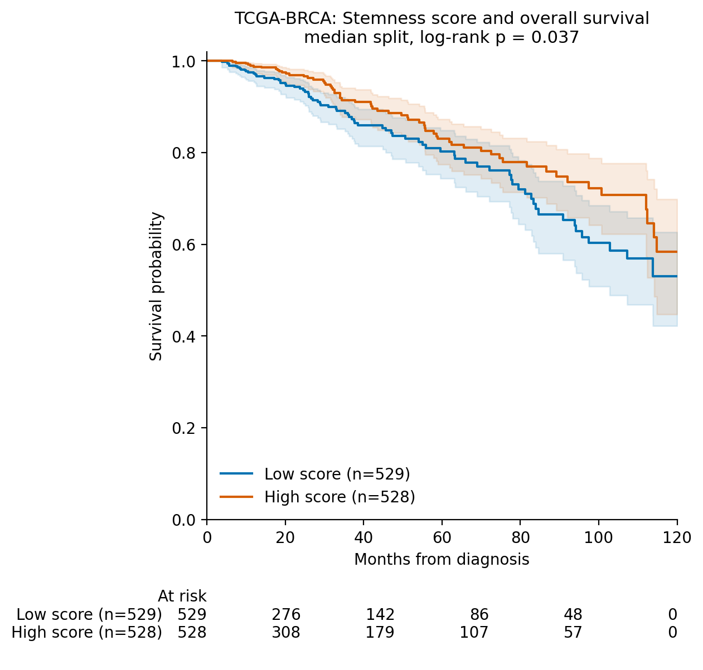
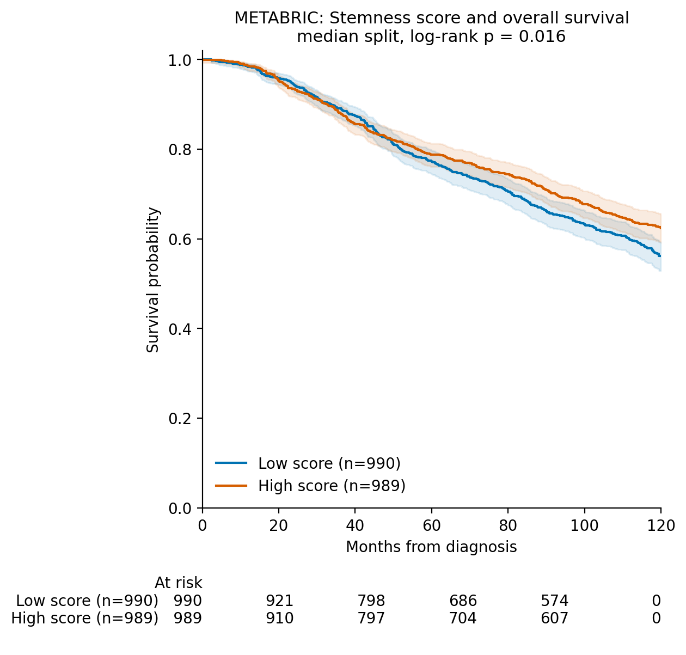
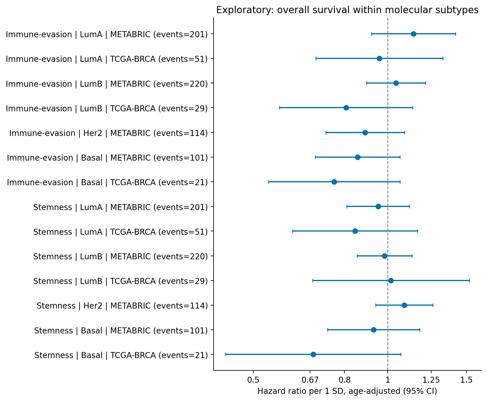
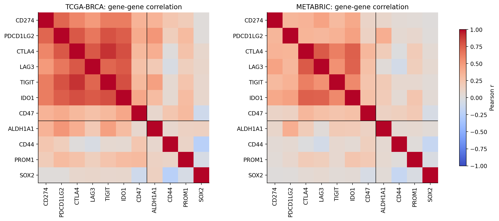

# Do immune-evasion and stemness gene scores track survival in breast cancer?

A survival analysis in TCGA-BRCA, replicated in METABRIC.

[](https://colab.research.google.com/github/dochieng014-code/breast-cancer-immune-stemness-survival/blob/main/breast_cancer_signature_survival.ipynb)

## Why I did this

My review on immune editing of stem cell fate in cancer (Journal of Cancer and Tumor International, 2026) argued that tumours which escape immune control and tumours with stem-like features are closely linked. I wanted to see whether that idea leaves a measurable trace in real patient data, using only public cohorts and a signature I fixed before looking at any outcome.

I come from a wet-lab biochemistry background, so this project is also my way of showing that I can take a biological question all the way to a reproducible statistical answer.

## The question

1. Do tumours with a high **immune-evasion** score have different overall survival from tumours with a low score?
2. Do tumours with a high **stemness** score have different overall survival from tumours with a low score?
3. Is the pattern seen in TCGA-BRCA reproduced in METABRIC, an independent cohort measured on a different platform?

## Data

Both cohorts are public and de-identified, downloaded from the cBioPortal data hub. Nothing in this repository comes from a private data source.

| Cohort | cBioPortal study | Expression platform | Role |
|---|---|---|---|
| TCGA-BRCA | `brca_tcga_pan_can_atlas_2018` | RNA-seq (RSEM) | Discovery |
| METABRIC | `brca_metabric` | Illumina microarray | Validation |

Exact sample counts at every filtering step are written to `results/sample_flow.csv` when the notebook runs.

## The signature

I chose the genes from biology and fixed them in advance. They are not weighted or fitted to survival, so there is no training step that could overfit.

| Module | Genes |
|---|---|
| Immune evasion | CD274, PDCD1LG2, CTLA4, LAG3, TIGIT, IDO1, CD47 |
| Stemness | ALDH1A1, CD44, PROM1, SOX2 |

Only genes present in both cohorts are used, and the notebook stops with a clear message instead of quietly changing the signature if a module loses too many genes.

One caution I built into the design: several checkpoint genes are mostly expressed by immune cells inside the tumour. A high immune-evasion score can therefore mean a heavily inflamed tumour, which in some subtypes goes with better outcome. For this reason the two modules are analysed separately and I did not assume a direction in advance.

## Methods in brief

1. Keep primary tumours, one sample per patient, women only. Follow-up is censored at 10 years in both cohorts.
2. Put expression on a log2 scale, convert each gene to a z-score **within each cohort**, and average the genes in each module. This removes the platform difference between RNA-seq and microarray without using any outcome information.
3. **Primary analysis:** Cox proportional-hazards model for overall survival, hazard ratio per 1 SD of the score.
4. **Adjusted model:** age, stage and molecular subtype, with a proportional-hazards check and Harrell's C-index.
5. **Kaplan-Meier curves** (median split) with log-rank test, for display.
6. **Replication rule, written before running:** a module counts as replicated if the METABRIC effect has the same direction as TCGA-BRCA and its 95% confidence interval excludes 1.
7. Exploratory only: the combined score, secondary endpoints (progression-free survival in TCGA, relapse-free and disease-specific survival in METABRIC), and subtype-specific models. Benjamini-Hochberg adjusted p-values are reported across all tests.

Tools: Python (pandas, lifelines, matplotlib) in Google Colab.

## Results

These come from the real run on 25 October 2026, with follow-up censored at 120 months. Full tables are in `results/` and all figures are in `figures/`.

**Who was analysed**

- **TCGA-BRCA:** 1,070 women had expression data. Of these, 1,057 had overall survival data, with 138 deaths.
- **METABRIC:** the clinical file lists 2,509 patients, but only 1,980 had expression data. Of these, 1,979 had survival data, with 760 deaths.

Step-by-step counts are in `results/sample_flow.csv`.

**Primary analysis: overall survival, hazard ratio per 1 SD of the score**

| Cohort | Module | HR (95% CI) | p | p after BH correction | Adjusted HR (95% CI) | Adjusted p |
|---|---|---|---|---|---|---|
| TCGA-BRCA | Immune evasion | 0.84 (0.71-0.99) | 0.039 | 0.073 | 0.86 (0.71-1.04) | 0.111 |
| TCGA-BRCA | Stemness | 0.78 (0.65-0.94) | 0.008 | 0.030 | 0.84 (0.69-1.02) | 0.075 |
| METABRIC | Immune evasion | 1.02 (0.95-1.09) | 0.548 | 0.587 | 0.92 (0.83-1.02) | 0.102 |
| METABRIC | Stemness | 0.92 (0.86-0.99) | 0.031 | 0.066 | 0.98 (0.90-1.08) | 0.690 |

A hazard ratio below 1 means a higher score went with *better* survival. "Adjusted" means adjusted for age, stage and molecular subtype. The adjusted models use only patients with all three recorded: 950 patients (114 deaths) in TCGA-BRCA and 1,451 patients (548 deaths) in METABRIC, so they are not run on exactly the same patients as the unadjusted ones. "After BH correction" is the p-value corrected for the 15 models run in total (Benjamini-Hochberg, see references); the other p-values are nominal. All values are in `results/survival_results.csv`.

**Replication (the rule I fixed beforehand)**

- **Immune evasion: not replicated.** The hazard ratio was 0.84 in TCGA-BRCA but 1.02 in METABRIC, so the direction did not hold and the METABRIC interval includes 1.
- **Stemness: met the replication rule in the unadjusted analyses, with important caveats.** The unadjusted hazard ratios were 0.78 in TCGA-BRCA (95% CI: 0.65–0.94) and 0.92 in METABRIC (95% CI: 0.86–0.99). Both estimates were below 1, meaning a higher stemness score went with *better* survival, and both confidence intervals excluded 1, although the METABRIC interval only narrowly. However, the METABRIC result is borderline after correcting for the 15 models run (p = 0.066), and the association weakened after adjustment for age, stage and molecular subtype. The adjusted hazard ratio was 0.84 in TCGA-BRCA (95% CI: 0.69–1.02) and 0.98 in METABRIC (95% CI: 0.90–1.08); both adjusted confidence intervals included 1.

**Kaplan-Meier curves (median split, log-rank test)**

| Score | TCGA-BRCA | METABRIC |
|---|---|---|
| Immune evasion | high score did better, p = 0.066 | high score did worse, p = 0.050 |
| Stemness | high score did better, p = 0.037 | high score did better, p = 0.016 |

**Other checks**

- The proportional-hazards assumption looked doubtful for METABRIC immune evasion even after adjustment (test p between 0.012 and 0.015 for overall, relapse-free and disease-specific survival). Several unadjusted METABRIC models were also flagged, including overall survival for stemness (p = 0.001). For those models the hazard ratio is an average over time and should be read cautiously.
- Secondary endpoints (exploratory; progression-free survival in TCGA-BRCA is not the same measure as relapse-free survival in METABRIC): in TCGA-BRCA all three scores went with better progression-free survival, and this held after adjustment (immune evasion 0.78, 0.64-0.94; stemness 0.78, 0.63-0.95; combined 0.73, 0.60-0.90). In METABRIC the adjusted relapse-free estimates sat close to 1 (immune evasion 0.94, 0.85-1.04; stemness 0.99, 0.90-1.09). For disease-specific survival in METABRIC, higher immune evasion looked worse before adjustment (1.10, 1.01-1.19) but not after (0.94, 0.84-1.06).
- Within molecular subtypes (exploratory), every confidence interval included 1. In TCGA-BRCA the subtype groups were small, with 21 to 51 deaths each, and HER2 had too few events to model.
- The gene-gene correlation plot shows that the immune genes CTLA4, LAG3, TIGIT and IDO1 move together strongly, while CD47 sits more apart. The four stemness genes hardly correlate with each other, and CD44 and SOX2 correlate slightly negatively in both cohorts. In TCGA-BRCA, ALDH1A1 also tracks several of the immune genes.















## What I take from this

This signature does not behave like a reliable prognostic marker in these two cohorts. The immune-evasion score pointed one way in TCGA-BRCA and showed no association in METABRIC. The stemness score went with better survival in both cohorts, which is the opposite of what a "stemness means worse outcome" reading would predict, and the association faded once age, stage and subtype were taken into account. The one place an association survived adjustment was progression-free survival in TCGA-BRCA, an exploratory endpoint that METABRIC did not mirror. The overall pattern fits the score partly reflecting differences in tumour subtype or clinical profile rather than an independent effect, but these analyses cannot tell me which factor is responsible. I am reporting the result as it came out, including that the pre-specified replication rule was met only by the unadjusted stemness result.

## Limitations

- Both cohorts are retrospective and mostly from patients in Europe and North America. These results say nothing about whether the scores behave the same way in African patients; answering that needs African cohorts, and public data of that kind are scarce.
- The signature is small and was chosen from biological reasoning, not optimised. A different reasonable gene list could give a different answer.
- The four stemness genes barely correlate with each other, so their average may not measure one coherent biological programme. The immune-evasion score also cannot separate "the tumour is evading the immune system" from "the tumour is heavily infiltrated by immune cells".
- An association with survival does not show that these genes cause the outcome or that they are drug targets.
- TCGA-BRCA has short follow-up and relatively few deaths (138), so its estimates are imprecise. METABRIC has longer follow-up but different treatment eras and a different platform, and only 1,980 of its 2,509 listed patients had expression data.
- Many models were run. The nominal p-values for the primary analysis (0.008 to 0.04) are modest, and after correcting for the 15 models only TCGA-BRCA stemness stays below 0.05 (0.030).
- The adjusted models drop patients with missing age, stage or subtype, so they use fewer patients than the unadjusted models.
- Overall survival in METABRIC includes deaths from other causes, so I also report disease-specific survival there.

## Run it yourself

1. Click the Colab badge at the top of this page.
2. *Runtime → Run all*. The first run downloads the two cohorts (a few hundred MB) and takes roughly 10-20 minutes.
3. Outputs appear in `results/` (tables, `summary.md`, `run_info.json` with software versions and file checksums) and `figures/`. The last cell zips them for download.

To test the code without downloading anything, set `USE_DEMO_DATA = True`. That uses simulated data, writes to `demo_outputs/` and stamps every figure "SIMULATED DEMO DATA". Those outputs must never be quoted as findings.

Files:

```
breast_cancer_signature_survival.ipynb   the whole analysis, start to finish
requirements.txt                          packages (Colab already has most)
results/                                  tables, summary.md, run_info.json from the real run
figures/                                  all figures from the real run
```

## How I used AI tools

I used Claude to help design the analysis structure and write and debug the code. I reviewed the method, ran the notebook myself, and I am responsible for the interpretation. The code was tested on simulated data with a known built-in effect to confirm that hazard-ratio directions come out correctly before it was pointed at real cohorts.

## References

Baird, R. D., & Caldas, C. (2013). Genetic heterogeneity in breast cancer: The road to personalized medicine? *BMC Medicine, 11*, Article 151. https://doi.org/10.1186/1741-7015-11-151

Benjamini, Y., & Hochberg, Y. (1995). Controlling the false discovery rate: A practical and powerful approach to multiple testing. *Journal of the Royal Statistical Society: Series B (Methodological), 57*(1), 289–300. https://doi.org/10.1111/j.2517-6161.1995.tb02031.x

Cancer Genome Atlas Network. (2012). Comprehensive molecular portraits of human breast tumours. *Nature, 490*(7418), 61–70. https://doi.org/10.1038/nature11412

Cerami, E., Gao, J., Dogrusoz, U., Gross, B. E., Sumer, S. O., Aksoy, B. A., Jacobsen, A., Byrne, C. J., Heuer, M. L., Larsson, E., Antipin, Y., Reva, B., Goldberg, A. P., Sander, C., & Schultz, N. (2012). The cBio cancer genomics portal: An open platform for exploring multidimensional cancer genomics data. *Cancer Discovery, 2*(5), 401–404. https://doi.org/10.1158/2159-8290.CD-12-0095

Cox, D. R. (1972). Regression models and life-tables. *Journal of the Royal Statistical Society: Series B (Methodological), 34*(2), 187–202. https://doi.org/10.1111/j.2517-6161.1972.tb00899.x

Curtis, C., Shah, S. P., Chin, S.-F., Turashvili, G., Rueda, O. M., Dunning, M. J., Speed, D., Lynch, A. G., Samarajiwa, S., Yuan, Y., Gräf, S., Ha, G., Haffari, G., Bashashati, A., Russell, R., McKinney, S., METABRIC Group, Langerød, A., Green, A., . . . Aparicio, S. (2012). The genomic and transcriptomic architecture of 2,000 breast tumours reveals novel subgroups. *Nature, 486*(7403), 346–352. https://doi.org/10.1038/nature10983

Davidson-Pilon, C. (2019). lifelines: Survival analysis in Python. *Journal of Open Source Software, 4*(40), 1317. https://doi.org/10.21105/joss.01317

Sammut, S.-J., Crispin-Ortuzar, M., Chin, S.-F., Provenzano, E., Bardwell, H. A., Ma, W., Cope, W., Dariush, A., Dawson, S.-J., Abraham, J. E., Dunn, J., Hiller, L., Thomas, J., Cameron, D. A., Bartlett, J. M. S., Hayward, L., Pharoah, P. D., Markowetz, F., Rueda, O. M., . . . Caldas, C. (2022). Multi-omic machine learning predictor of breast cancer therapy response. *Nature, 601*(7894), 623–629. https://doi.org/10.1038/s41586-021-04278-5

## Author

Dickens Agie, Biochemist, Nairobi, Kenya
dochieng014@gmail.com

## Licence

Code: MIT. Please cite this repository if you reuse it. The underlying data belong to their original studies; follow cBioPortal's terms of use.
